<picture>
  <source media="(prefers-color-scheme: dark)" srcset="figures/hero-dark.svg">
  
</picture>

**Exportar vídeos do Remotion numa placa NVIDIA e deixar a CPU livre.** Num vídeo de produção de 75 s, com apresentador e gráficos animados, o render em camadas gastou **112 s de CPU em vez de 460 s** (4,1× menos) e terminou em 49 s em vez de 111 s. A comparação é com o caminho de GPU do próprio Remotion, `<Video>` + NVENC, na mesma máquina.

English: [README.md](README.md). As figuras estão em inglês; os textos alternativos e as legendas abaixo resumem cada uma.

<picture>
  <source media="(prefers-color-scheme: dark)" srcset="figures/r-steps-dark.svg">
  
</picture>

Segundos de trabalho por segundo de vídeo, em duas janelas de medição: um trecho de 15 s (N=2) e o vídeo inteiro (N=1 e N=4). Compare as barras só dentro da mesma janela.

## Aonde isto quer chegar

O objetivo deste kit é tirar do Chrome o trabalho de vídeo de uma exportação do Remotion (decodificar, recortar,
enquadrar, compor) e levá-lo para a GPU, deixando no Chrome só os gráficos, enquanto você continua escrevendo o vídeo
em React do mesmo jeito. Só o NVENC não é isso; o Remotion já oferece.

Hoje isso funciona para uma família de vídeos: filmagem com recorte, posição e zoom, mais gráficos por cima. Duas coisas
ampliariam isso, e as duas precisam de gente de fora da Konecz: **compatibilidade** com composições mais ricas e
**evidência em outras GPUs**. Veja o [roteiro](#roteiro).

## Como funciona

Num render do Remotion com vídeo dentro, o React não é o problema. Quase toda a CPU vai para decodificar o vídeo e para capturar cada quadro.

<picture>
  <source media="(prefers-color-scheme: dark)" srcset="figures/cpu-breakdown-dark.svg">
  
</picture>

Por isso o vídeo sai do navegador. O mesmo código React que enquadra o apresentador (caixa, recorte, zoom lento, punch-in, mola até o cartão) escreve um **plano de enquadramento**. O Chrome desenha só os gráficos, em PNG com transparência. O ffmpeg faz o resto na placa.

<picture>
  <source media="(prefers-color-scheme: dark)" srcset="figures/pipeline-dark.svg">
  
</picture>

- O plano vira expressões do `libplacebo` em trechos de reta, com erro de no máximo 0,05 px.
- O `libplacebo` mistura em luz linear e o Chrome mistura com gama. As entradas são marcadas para a mistura sair igual à do Chrome.
- O vídeo de 25 quadros/s vira saída de 30 quadros/s escolhendo o quadro como o Remotion escolhe (`fps=30:round=up`).
- O **dedup** (opcional) tira um hash do estado da página antes de cada captura. Quadro com estado já capturado vira link para o PNG gravado. No vídeo R, 29% dos quadros foram reaproveitados, e todos saíram iguais byte a byte a uma captura nova.

## Qual caminho usar

<picture>
  <source media="(prefers-color-scheme: dark)" srcset="figures/decision-dark.svg">
  
</picture>

- **Sem vídeo dentro da composição:** P1 (Remotion com Vulkan e saída NVENC).
- **Um take por vez, como retângulo na tela:** camadas com dedup.
- **Vários takes ao mesmo tempo, máscara, rotação ou desfoque no vídeo:** P1.
- **Slides, quase tudo parado:** o dedup ajuda.

## Início rápido

Requisitos:

- Linux;
- placa NVIDIA com NVENC;
- ffmpeg 7 ou mais novo, com libplacebo e Vulkan;
- Node 20 ou mais novo;
- Remotion 4.0.536.

```sh
npm install
npm run doctor            # confere o ffmpeg, o driver da NVIDIA, o Vulkan e o Remotion, caminho por caminho
npm run example:p1        # o vídeo de exemplo pelo Remotion + <Video> + NVENC
npm run example:layers    # o mesmo vídeo pelo render em camadas
npm test
```

O exemplo gera o próprio vídeo sintético no primeiro uso, sem baixar mídia. As saídas ficam em `examples/presenter/out/`.

## Com o Claude Code

O projeto foi feito com o [Claude Code](https://claude.com/claude-code) e traz uma skill para quem edita vídeo com o Claude.

- `.claude/skills/remotion-gpu/SKILL.md` ensina o Claude a escolher o caminho, escrever composições que o render em camadas aceita e medir antes e depois.
- [docs/claude-code.md](docs/claude-code.md) explica como instalar a skill no seu projeto Remotion e o que pedir.

## Benchmark, e como mandar os seus resultados

Os vídeos sintéticos A a E cobrem tipografia, apresentador, vários vídeos ao mesmo tempo, efeitos pesados e slide. O piloto abaixo tem **N=1 e 4 s por célula, então é só indicativo**. A rodada rápida que veio depois parou na metade e ordena os caminhos do mesmo jeito.

<picture>
  <source media="(prefers-color-scheme: dark)" srcset="figures/pilot-dark.svg">
  
</picture>

<picture>
  <source media="(prefers-color-scheme: dark)" srcset="figures/quality-dark.svg">
  
</picture>

Qualidade: o SSIM de cada caminho fica a até 0,008 do piso de ruído, que é a referência recodificada pelo mesmo codificador sem mais nenhuma mudança. A maioria fica a até 0,002.

```sh
npm run bench:smoke       # N=1, 4 s: confere que todos os caminhos rodam na sua máquina
npm run bench:quick       # N=3, 15 s, 1080p
npm run bench:full        # N=5, 30 s, 1080p e 4K (horas; deixe rodando de madrugada)
```

Cada execução grava `bench/results/<execução>/` com as rodadas brutas, o ambiente, uma análise e um `submission.json`, o arquivo único para anexar a uma issue de resultado de benchmark. Leia antes de mandar. **Só temos números de uma RTX 5090 num servidor ocupado.** Resultados de outras placas, de AMD ou Intel, de notebooks e de máquinas ociosas são a contribuição mais útil. O [CONTRIBUTING.md](CONTRIBUTING.md) explica como mandar.

## O que não funcionou

<picture>
  <source media="(prefers-color-scheme: dark)" srcset="figures/negative-dark.svg">
  
</picture>

- **Decodificar na placa dentro do Chrome sem janela (VA-API):** o decodificador abre, mas o processo de GPU do Chrome cai ao entregar o quadro. O `dec` da placa fica em 0%.
- **Capturar só a área que mudou:** a captura cai 19 s, mas recompor em Node custa 32,4 s, contra 8,1 s do ffmpeg decodificando os PNG inteiros. Além disso, 816 de 2241 quadros não batem pixel a pixel.
- **`Experimental.Clipper` do Remotion:** foi removido em 2024 porque deixava o render mais lento. O nosso protótipo chegou ao mesmo resultado.
- **Gráficos por memória compartilhada + NVENC:** 35,3 s contra 27,7 s da sequência PNG.
- **ProRes 4444 ou VP9 com alfa na camada de gráficos:** codificar custa +86,8 s ou +20,0 s para economizar no máximo 2,4 s de decodificação.
- **Vários segmentos do ffmpeg ao mesmo tempo:** com dois, a parede cai 28% e a CPU sobe 20%. Fica como opção, desligada.

## O que é novo e o que não é

Muito disso já existia, e o artigo cita:

- o próprio Remotion recomenda o `<Video>` do `@remotion/media` e tem saída em NVENC;
- o HyperFrames já compõe o vídeo fora do navegador, em camadas e na CPU, e já pula quadros repetidos por padrão;
- o CasparCG compõe gráficos HTML sobre vídeo na GPU, em tempo real;
- o `Experimental.Clipper` do Remotion tentou a captura parcial e foi removido porque deixava o render mais lento.

O que acrescentamos:

- o enquadramento escrito no componente React vira um plano que roda de ponta a ponta na placa (NVDEC, libplacebo, NVENC);
- o resultado é medido contra o render do Chrome, ao lado do piso de ruído do codificador;
- os números de CPU e o benchmark são publicados como dados abertos.

## Roteiro

**Evidência em mais placas.** Todos os números até agora vêm de uma RTX 5090 num servidor ocupado.

| Placa | Situação |
|---|---|
| RTX 5090, Linux | medida (este repositório) |
| RTX 3060, 4060, 4070, 4090 | procurada: rode `bench:quick` e mande o resultado |
| Placas profissionais (RTX série A, L4) e T4 na nuvem | procuradas |
| GPUs de notebook | procuradas |
| AMD e Intel (VA-API) | ainda sem suporte: o P2 precisa de um caminho VA-API |
| Só CPU | roda (`--device cpu`), como linha de base |

**Compatibilidade.** O que hoje deixa uma composição no P1, na ordem em que pretendemos atacar:

- [ ] vários takes na tela ao mesmo tempo (picture-in-picture, grades);
- [ ] máscara, rotação e desfoque na filmagem, feitos na GPU;
- [ ] transições entre takes;
- [ ] ler o plano de enquadramento de qualquer `<Video>` da composição, sem um componente feito para isso;
- [ ] dedup em versões do Remotion depois da 4.0.536 (de preferência por um gancho público no próprio Remotion, em vez de remendo).

**Método.** Uma rodada completa do benchmark (N≥5, máquina ociosa, 4K) e o HyperFrames como mais uma linha de base.

Ideias e resultados vão para as [Discussions](https://github.com/konecz/remotion-gpu/discussions); resultado de
benchmark, numa issue com o modelo **Benchmark result**.

## Artigo

O [paper/artigo.md](paper/artigo.md) (português) e o [paper/paper.md](paper/paper.md) (inglês) trazem o método, os resultados, as ameaças à validade e as referências. Todo número vem de [data/](data), e o [data/README.md](data/README.md) diz, para cada um, a origem, o número de rodadas, a duração do trecho e a carga da máquina.

## Avisos

- **O Remotion tem licença própria.** Empresas acima de certo tamanho precisam de licença paga; veja [remotion.dev/license](https://www.remotion.dev/license). Este projeto não muda isso.
- **A Konecz não é afiliada ao Remotion.**
- **O dedup usa uma parte interna do Remotion** (o `takeFrame` do `@remotion/renderer`). Ele só funciona na versão 4.0.536 e se recusa a rodar em qualquer outra. O resto funciona sem ele.
- **Os números são de uma máquina só**: Ryzen 7 7700X e RTX 5090, dividida com sites em produção e um servidor de LLM residente, com teto de 8 dos 16 fios. As suas razões vão ser outras.

## Licença

MIT, veja [LICENSE](LICENSE). As fontes embutidas nas figuras (Schibsted Grotesk e IBM Plex Mono) são da SIL Open Font License; veja `figures/build/fonts/`.

Feito pela [Konecz](https://konecz.com) com o Claude Code.
