# Exporting Remotion videos on the GPU: a layered render, measured against Chrome

**Konecz** · October 2026 · Remotion 4.0.536 · [Português](artigo.md)

## Abstract

Remotion renders React compositions to video by capturing each frame from headless Chrome. When the composition embeds camera footage, most of the CPU goes to decoding that footage and capturing frames, not to React. We describe `remotion-gpu`, an open tool with three paths: P1 (Remotion's own `<Video>` and NVENC), P2 (a layered render: the framing written in React is exported as a per-frame plan and executed on the GPU by ffmpeg with Vulkan Video, libplacebo and NVENC, while Chrome draws only the graphics) and P3 (P2 plus skipping repeated graphics frames). On a 75 s production video, P3 used 112 s of CPU (N=4) against 460 s for P1 (N=1); the layered output matched P1 at mean SSIM 0.978 (N=1). Every number comes with its run count and machine load; the cross-video benchmark is a pilot (N=1, 4 s). The contribution is systems work and measurement, not a new algorithm. We also report what did not work.

## 1. Introduction

Code-driven video (Remotion, HyperFrames and similar tools) runs a browser per frame. That is flexible and expensive. On a server that also hosts production web sites, the CPU is the scarce resource; a large GPU often sits idle.

The question: **how much CPU can a Remotion export give back when decode, composition and encode move to an NVIDIA GPU, and at what cost in visual fidelity?**

What we did:

| # | Item | Section |
|---|---|---|
| 1 | Measured where the CPU goes in a Remotion render with footage | 5.1 |
| 2 | Measured Remotion's own GPU path (P1), step by step | 5.2 |
| 3 | Built a layered render (P2) driven by a plan compiled from the React framing code | 4 |
| 4 | Matched it to Chrome's output (blend space, source-frame choice) and measured SSIM against the encoder's noise floor | 5.4 |
| 5 | Added DOM-state dedup of graphics frames (P3) | 5.5 |
| 6 | Wrote an open benchmark harness and ran a pilot | 5.6 |
| 7 | Recorded the approaches that failed | 6 |

## 2. Related work

A review on 2026-10-29 opened and read 65 sources (documentation, code, papers, patents). We found **no peer-reviewed work on web-to-video rendering with a headless browser**, and no published measurement of CPU by stage for Remotion with embedded footage.

### 2.1 What is not new

| Idea | Prior art |
|---|---|
| Decoding video inside Chrome and capturing frames is the bottleneck | HyperFrames' write-up ("We don't let Chrome decode and schedule video") [14]; Replit's engine [15]; Remotion's performance page [1]; Remotion PR #12109 (faster capture) [5]; Remotion issue #4364 [4] |
| `<Video>` from `@remotion/media` + NVENC | Official recommendation and feature [1][2][9] |
| Skipping repeated frames | HyperFrames PR #1549 (GSAP timeline prediction, on by default) [11] and PR #2248 (`hasDamage` from `beginFrame`) [12]; ffmpeg `mpdecimate` [32]; Rendering Elimination in GPU hardware [39][40]; Chrome's own compositor [46] |
| Graphics with alpha composited over video outside the browser | HyperFrames HDR layered compositor (CPU, per-frame DOM geometry) [13]; CasparCG (live, GPU mixer, tweens by command) [25]; OBS browser source [26]; OpenMontage #45 [21]; remotion-ffmpeg-skill [22]; scorsese #775 [23]; Remotion's ProRes 4444 workflow [7] |
| Animation as data, executed by an engine | Lottie [34]; GStreamer controllers [29]; Editly [19]; Shotstack [24]; Vidformer, V2V, Vega-Video [36][37][38]; motion vectorization, gMotion, MoVer, DataMagic [42][43][44][45] |
| Capturing only the changed area (dirty rects) | Remotion `Experimental.Clipper`, removed in 2024 because "it did not actually make the render faster, rather slower" [6]; CEF `OnPaint` dirty rects [27]; CDP `hasDamage` [28] |

The closest work is **HyperFrames**. Its HDR compositor already splits graphics (PNG with alpha) from video and blends them outside Chrome, but reads geometry from the live DOM every frame and blends on the CPU in JavaScript; its published number is wall time ("~12 min for 19 s", 4K HDR) [13]. Its dedup is off with embedded video [11].

The basic method (headless browser screenshots at fixed intervals, assembled into video) is covered by a granted patent [47]; it does not mention GPUs, layers or repeated frames.

Other context. Deterministic capture with a virtual clock goes back to timecut and timesnap [17]; WebVideoCreator [16] uses `beginFrame`; Motion Canvas and Revideo [18] export image sequences. Remotion's client-side renderer [8] encodes through WebCodecs [33] and Mediabunny [35] and does not mention the GPU. One browser editor cut frame time by caching rasterised content and re-applying only the affine transform and alpha [20]: the same intuition as layers, inside the browser and on the CPU. NVIDIA DeepStream draws fixed primitives over video on the GPU [30]. URL2Video [41] turns a web page into a video, but studies design, not render cost.

### 2.2 What looks new (after this search)

1. **React → plan → GPU, end to end.** The framing function the composition uses (spring, slow zoom, punch-in) is sampled in Node before the render, compressed into straight segments with ≤ 0.05 px error and executed by ffmpeg on the GPU from decode to encode. Chrome never sees the footage.
2. **Measured visual equivalence against Chrome.** Blend space (linear light vs gamma), source-frame choice (25 → 30 fps), SSIM frame by frame against the encoder's own noise floor.
3. **The numbers**, with CPU from the cgroup, run counts and load.
4. **An open benchmark harness** with CPU, wall, memory, GPU utilisation and quality per cell.

### 2.3 Coverage

● covers, ◐ partly, ○ no. Columns: (a) CPU by stage measured, (b) `<Video>`/NVENC, (c) layers composed outside the browser, (d) repeated frames or damage, (e) published benchmark with method.

| Work | a | b | c | d | e |
|---|---|---|---|---|---|
| Remotion docs [1][2][3] | ◐ | ● | ○ | ○ | ○ |
| Remotion PR #12109 [5] | ◐ | ○ | ○ | ○ | ◐ |
| Remotion `Experimental.Clipper` [6] | ○ | ○ | ○ | ◐ | ○ |
| HyperFrames capture engine [10][11][12] | ◐ | ◐ | ○ | ● | ○ |
| HyperFrames HDR compositor [13] | ○ | ○ | ◐ | ○ | ○ |
| CasparCG [25] / OBS [26] | ○ | ○ | ◐ | ◐ | ○ |
| OpenMontage #45 [21] / remotion-ffmpeg-skill [22] | ◐ | ○ | ◐ | ○ | ○ |
| Shotstack benchmark [24] | ○ | ○ | ◐ | ○ | ◐ |
| Vidformer / V2V [36][37] | ○ | ○ | ◐ | ○ | ◐ |
| Rendering Elimination [39] | ○ | ○ | ○ | ◐ | ○ |
| **This work** | ● | ● | ● | ● (variant) | ● (pilot) |

## 3. Method

### 3.1 Environment

| Item | Value |
|---|---|
| CPU | AMD Ryzen 7 7700X, 16 threads, governor `performance` |
| RAM | 62 GB |
| GPU | NVIDIA GeForce RTX 5090, 32 GB, driver 595.99.02 |
| OS | Ubuntu 26.04.1 LTS, kernel 7.0.0 |
| Node | 24.22.0 |
| Remotion | 4.0.536, `chrome-headless-shell` 157 |
| ffmpeg | 8.0.1 (system, with libplacebo, without libvmaf); n7.1 inside Remotion |
| Background load | production web sites, 5 CI virtual machines, other agents. 1-min load at round start: pilot median 3.94 (max 7.53), quick median 4.54 (max 7.57) |
| Shared GPU | a resident LLM inference server (llama-server) held ~21 GB of VRAM; idle in the sample before each round |

All measurements were taken on 2026-10-29 on this one machine.

### 3.2 Metrics

| Metric | Definition |
|---|---|
| **CPU** (main) | `user_usec + system_usec` from `cpu.stat` of the render's own systemd scope |
| CPU per second of video | CPU ÷ video duration |
| Wall | monotonic clock, spawn to exit |
| Memory | cgroup `memory.peak`; peak anonymous memory sampled every 0.5 s |
| GPU | `nvidia-smi dmon`: sm, enc, dec, VRAM. **Whole card** |
| Quality | SSIM (mean, worst frame, 1st percentile) and PSNR in RGB; each video decoded by its own colour tags; frames paired by index. VMAF unavailable |
| Noise floor | the reference re-encoded by the path's encoder with nothing else changed, against itself |

**Why the cgroup CPU.** The scarce resource is the CPU the other services need. Remotion spawns Chrome processes, a compositor and ffmpeg; the cgroup counts every descendant. An earlier tool (`/usr/bin/time`) missed Chrome's children and under-counted by more than half. No number here comes from it, except the first feasibility test (Table 1), where ffmpeg is a single process.

### 3.3 Protocol

| Step | Detail |
|---|---|
| Containment, same for every path | `systemd-run --user --scope -p CPUQuota=800% nice -n 19 ionice -c 3`: at most 8 of 16 threads |
| Warm-up | one pass over all cells, discarded |
| Order | shuffled each repetition (Fisher–Yates, seed 20261029) |
| Quiet-machine wait | no other render; 1-min load < 8; busy CPU < 35% in two checks in a row. If the wait times out, the round runs and is flagged |
| Before/after experiments | rounds alternated between variants, because load moved |
| Analysis | median, IQR, percentile-bootstrap CI of the median (10 000 resamples, fixed seed). With N=1 there is no interval |

### 3.4 Measurement windows

Numbers from different windows are never divided by each other.

| Window | Video | Frames | Length |
|---|---|---|---|
| seg375 | R, 1080×1920 | 375–824 | 15 s |
| seg600 | R, 1080×1920 | 600–1049 | 15 s |
| whole | R, 1080×1920 (and 1920×1080) | 0–2240 | 74.7 s |
| pilot | A–E, R (1920×1080 from frame 375), S | 120 per cell | 4 s |
| quick (partial) | A–E, R | 450 per cell | 15 s |

**R** is a production talking-head explainer, 75 s: a presenter (1920×1080 H.264, 25 fps, six takes) plus motion graphics, rendered at 30 fps. No frame of it is published. **A–E** are synthetic: A kinetic typography, B presenter (full screen ↔ card, zoom, punch-in, captions), C 2×2 grid and picture-in-picture (2–4 takes at once), D heavy effects (`blur(70px)`, `backdrop-filter`, `feTurbulence`), E slide with mostly still frames. **S** is a second production video, P0 only.

### 3.5 What is an estimate

Before the cgroup measurement existed, we projected about 1100 s of CPU for the whole of R (about 28 s of CPU per second of video) from watching processes during a loaded render. **These are estimates, not measurements.** No table or figure uses them.

## 4. System

<picture>
  <source media="(prefers-color-scheme: dark)" srcset="../figures/pipeline-dark.svg">
  
</picture>

*Figure 1. The layered render (P2).*

### 4.1 Paths

| Path | Footage | Chrome GL | Capture | Encode | Code |
|---|---|---|---|---|---|
| P0 Remotion default | `<OffthreadVideo>` (Remotion compositor, CPU) | default (no `--gl`) | JPEG 80 | libx264 CRF 18 | — |
| P1 Remotion on GPU | `<Video>` from `@remotion/media` (WebCodecs, software in headless Chrome) | `--gl=vulkan` | JPEG 95 | `h264_nvenc` 12 Mb/s, `--hardware-acceleration=required` | `src/remotion-gpu.mjs` |
| P2 Layers | Vulkan Video (NVDEC) in ffmpeg | `--gl=vulkan`, graphics only | PNG with alpha | `h264_nvenc` CQ 19, preset p7 | `src/layers/` |
| P3 Layers + dedup | as P2 | as P2 | PNG, repeated states skipped | as P2 | `src/dedup/remotion-dedup.cjs` |

Each path is a bundle of choices, as a user would run it. P0 → P1 changes four things at once.

### 4.2 P1: Remotion on the GPU

`<Video disallowFallbackToOffthreadVideo />` makes the render fail instead of silently falling back to the CPU compositor. NVENC replaces `--crf` with a bitrate, since Remotion refuses CRF with hardware acceleration. **Decode stays on the CPU**: `nvidia-smi` showed `dec` at 0% in every P1 run.

### 4.3 P2: layers

| Step | What happens | Cost (seg600, N=3) |
|---|---|---|
| 1. Plan | esbuild bundles a small entry that imports the composition's framing function and Remotion's `spring`/`interpolate`; for each take it writes the box and the take rectangle **per frame**, plus audio entries. Validated against `plan.schema.json` | 0.2 s CPU (N=2) |
| 2. Graphics | the same composition, in graphics-only mode, renders a PNG sequence with alpha. The card's rounded corners are painted over by a solid shadow, so the take below can be a plain rectangle | 32.6 s CPU |
| 3. GPU | one ffmpeg per segment: Vulkan Video decode → `fps=30:round=up` → `libplacebo` [31] with N inputs (background, take, graphics) and per-frame `crop_*`/`pos_*` expressions → `hwupload=derive_device=cuda` → NVENC. Segments are joined without re-encoding; audio is mixed in the same step | 8.5 s CPU, audio included |

Details that matter:

| Choice | Reason |
|---|---|
| Per-frame curves → straight segments, greedy, error ≤ 0.05 px, nested `if(lt(K,…))` with `K = floor(ot*30+0.5)` | libplacebo takes expressions, not tables. A slow zoom is one segment; a spring 5–25 |
| Inputs and output tagged `color_trc=linear`, re-tagged BT.709 after | libplacebo blends in linear light, Chrome in gamma space. Declaring the values linear makes libplacebo blend as Chrome does |
| `fps=30:round=up` before libplacebo | picks the same 25 fps source frame as Remotion's video components |
| Solid background as the first input | covers the frame, so libplacebo never clears a Vulkan target (that fails validation) |
| One ffmpeg per segment; a segment also ends where the PNG colour type changes | ffmpeg's concat rejects Vulkan frames from different decoders; Chrome writes a fully opaque frame as RGB, and an RGBA ↔ RGB switch rebuilds the graph, which fails with Vulkan frames |
| Time ceiling per segment (0.2 s per frame, min 60 s) and one retry | one ffmpeg hung once (all threads waiting, no CPU); the same command passed on retry. Cause not found |
| Audio: `adelay` (exact samples) + `volume` + `amix` + `apad` | a Remotion WAV pass re-renders the whole composition (Section 6) |

Scope: one rectangular take at a time per segment. Several simultaneous takes (video C), free-form masks, blur or rotation on the footage are not supported.

### 4.4 P3: skipping repeated graphics frames

Before each capture, a SHA-256 of the page state: `documentElement.outerHTML`, every CSS rule (including `adoptedStyleSheets`), form values, scroll and viewport. A state captured before becomes a hard link to its PNG.

| Safety rule | Detail |
|---|---|
| Always captured | `<canvas>`, `<video>`, `<iframe>`, `<object>`, `<embed>`, SVG `<image>`, unloaded ``, loading fonts, running CSS animations or transitions, shadow DOM, cross-origin stylesheets |
| Not detected | a CSS `url()` background still loading (it would also break a normal render) |
| Version lock | patches the internal `takeFrame` export of `@remotion/renderer`; refuses any version other than 4.0.536 |
| Verify mode | `RGPU_DEDUP=verify` captures everything and checks that equal states gave byte-identical PNGs |

This is a variant of known dedup with another criterion (DOM state after seek, any earlier frame, no knowledge of the animation library), not a new idea.

### 4.5 Tooling

`bin/doctor.mjs` probes ffmpeg, NVENC, Vulkan Video decode, the libplacebo → CUDA → NVENC chain, Remotion's bundled encoder and the containment, and says which paths the machine supports. `src/measure.mjs` and `src/contain.mjs` implement Sections 3.2–3.3.

## 5. Evaluation

### 5.1 Where the CPU goes

<picture>
  <source media="(prefers-color-scheme: dark)" srcset="../figures/cpu-breakdown-dark.svg">
  
</picture>

*Figure 2. CPU by part, seg375, N=1 per mode. Source: `data/experiments/cpu-breakdown.json`.*

| Part | CPU (s) | Share | Derivation |
|---|---|---|---|
| Footage decode and handoff (`<OffthreadVideo>`) | 99.30 | 54.1% | full, no capture − graphics only, no capture |
| Frame capture (screenshot + JPEG) | 76.25 | 41.5% | full, JPEG − full, no capture |
| React, layout, start-up | 7.98 | 4.3% | graphics only, no capture (4.41 s fixed start-up; ~8.1 ms per frame beyond it) |
| **Total** | **183.53** | | `renderFrames()`, concurrency 4, `--gl=vulkan` |

Within the graphics alone (27.74 s with PNG capture), capture is 71% (85% without start-up). Caveat: subtraction assumes costs add up.

### 5.2 Video R, step by step

<picture>
  <source media="(prefers-color-scheme: dark)" srcset="../figures/r-steps-dark.svg">
  
</picture>

*Figure 3. Export of R by step. Two windows; do not compare across them. Source: `data/experiments/r-steps.json`.*

| Step | Window | N | CPU (s), mean [runs] | Wall (s) | CPU/s video | Memory peak |
|---|---|---|---|---|---|---|
| Start: `<OffthreadVideo>`, JPEG on disk, separate `h264_nvenc` | seg375 | 2 | 346.0 [317.5, 374.6] | 53.4 | 23.07 | 6.3 GB |
| `<Video>`, same pipeline | seg375 | 2 | 209.7 [220.8, 198.6] | 58.0 | 13.98 | 3.7 GB |
| `<Video>` + MP4 from Remotion, libx264 (control) | seg375 | 2 | 176.8 [175.2, 178.5] | 33.7 | 11.79 | 3.7 GB |
| `<Video>` + MP4 from Remotion, NVENC | seg375 | 2 | 121.1 [125.9, 116.3] | 29.9 | 8.07 | 3.2 GB |
| **P1**, with audio | whole | **1** | 460.3 | 110.7 | 6.16 | 3.8 GB |
| **P2** layers | whole | 4 | 128.5 [143.2, 131.0, 125.7, 114.1] | 52.3 | 1.72 | — |
| **P3** layers + dedup | whole | 4 | 112.2 [137.0, 104.0, 107.5, 100.4] | 49.0 | 1.50 | — |

- seg375: start → P1 settings, CPU −65% (N=2 each). From the means: `<Video>` −39%, MP4 straight from Remotion −16%, NVENC instead of libx264 −32%.
- Whole video: P1 / P3 = **4.1× CPU, 2.3× wall**. P1 is N=1 and was not alternated with P2/P3; P2 and P3 rounds were alternated.
- An earlier whole-video P1 run, on the same settings but on a busier machine with other renders running unconstrained, used 701 s of CPU (175 s wall). We report the lower value (460 s, matched by 460.2 s on the 1920×1080 version) so the 4.1× ratio is the conservative one; with the earlier run it would be 6.2×.
- 1920×1080 version, N=1 each: P1 460.2 s, P2 114.4 s, P3 101.0 s of CPU.
- `dec` stayed at 0% in every P1 run: WebCodecs decodes in software in headless Chrome.

### 5.3 Layered render by stage (seg600)

Reference here is a full Remotion render with `<OffthreadVideo>`, JPEG + NVENC, no audio. Load 3–4. Source: `data/experiments/layers-segment.json`.

| Stage | N | CPU (s) [runs] | Wall (s) | Memory | GPU sm/enc/dec |
|---|---|---|---|---|---|
| Remotion full render | 3 | 221.8 [214.2, 226.0, 225.2] | 36.9 | 6.4 GB | 9/2/0% |
| Layers: plan | 2 | 0.2 | 0.1 | 0.06 GB | — |
| Layers: graphics (PNG + alpha) | 3 | 32.6 [32.0, 32.9, 33.0] | 11.0 | 1.1 GB | 11/1/0% |
| Layers: ffmpeg on GPU + audio | 3 | 8.5 [8.5, 8.7, 8.4] | 6.3 | 0.5 GB | 11/8/1% |
| **Layers: total** | | **41.3** | **17.4** | | |

5.4× less CPU, 2.1× less wall. Of the 8.5 s in ffmpeg, 3.6 s is PNG decode. One ffmpeg round at load 16 took 13 s and is left out of the mean.

### 5.4 Equivalence with Chrome

Fixes found by comparing against Chrome's render (seg600, N=1; source `data/experiments/quality-r.json`):

| Fix | SSIM before | after |
|---|---|---|
| Blend in Chrome's space (tag as linear, re-tag BT.709) | 0.944 | 0.958 |
| Source frame with `fps=30:round=up` | 0.958 | 0.974 |
| Bilinear instead of spline36 scaling (rejected) | 0.974 | 0.949 |

Result on seg600: mean 0.9746, min 0.9647; noise floor (reference MP4 vs its own JPEG frames) 0.9855.

Whole video against P1, N=1:

| Block | 1080×1920 mean (min) | 1920×1080 mean (min) |
|---|---|---|
| 1 full screen, punch-in | 0.968 (0.736) | 0.973 (0.677) |
| 2 spring to card, map | 0.983 (0.967) | 0.986 (0.963) |
| 3 full screen, zoom 1.1, punch-in | 0.968 (0.816) | 0.974 (0.910) |
| 4 card, form | 0.983 (0.544) | 0.985 (0.544) |
| 5 card, form, hold after take ends | 0.986 (0.981) | 0.987 (0.982) |
| 6 full screen, punch-in, lower third | 0.967 (0.744) | 0.973 (0.680) |
| end card, no footage | 1.000 (1.000) | 1.000 (0.999) |
| **whole** | **0.978** | **0.981** |

Minima are isolated frames (123, 965, 1010, 1960, 1961) between neighbours at ~0.97: WebCodecs and `fps=30:round=up` pick a different 25 fps source frame in a few places. Not visible side by side. Audio: delay 0–0.33 ms, residual −58 to −62 dB per block.

<picture>
  <source media="(prefers-color-scheme: dark)" srcset="../figures/quality-dark.svg">
  
</picture>

*Figure 4. Pilot quality, 120 frames, N=1. Source: `data/benchmark/pilot-quality.csv`.*

Pilot: SSIM of each path minus the noise floor of its own encoder. Reference: P0 captured as PNG → ProRes 4444 XQ (for R, P1).

| Video | P0 | P1 | P2 |
|---|---|---|---|
| A typography | +0.0050 | −0.0001 | −0.0077 |
| B presenter 1080p | +0.0011 | +0.0008 | −0.0015 |
| B presenter 4K | +0.0016 | +0.0013 | −0.0003 |
| C multi-video | +0.0006 | −0.0042 | n/a |
| D effects | +0.0011 | −0.0003 | −0.0017 |
| E slide | +0.0001 | +0.0000 | −0.0004 |
| R production | ref. | +0.0001 | −0.0023 (min 0.958) |

### 5.5 Dedup (P3)

Whole video R, rounds alternated, load 4–9 (a single round can be off by ~15%). Source: `data/experiments/improvements.json`.

| Measure | Value |
|---|---|
| Frames reused | 652 of 2241 (29%) |
| Graphics CPU, before → after | 89.7 s (N=6) → 74.2 s (N=2), −17% |
| Graphics wall | 31.4 s → 28.8 s |
| Verify mode | 1584 states, 657 repeats, **0** differing PNGs (byte-exact) |
| SSIM vs P2 | 0.99698 (min 0.9917); P2 re-run vs itself 0.99723 (min 0.9919). 1920×1080: 0.99645 |

In the partial quick run (15 s, N=1): E (slide) reused 80% of frames and fell from 1.29 to 0.82 CPU s per video s; B reused 2% and did not change.

### 5.6 Benchmark: pilot and partial quick run

<picture>
  <source media="(prefers-color-scheme: dark)" srcset="../figures/pilot-dark.svg">
  
</picture>

*Figure 5. Pilot, N=1, 4 s per cell. Indicative only. Source: `data/benchmark/pilot-summary.json`.*

**Pilot** (N=1, 4 s, 120 frames; 5 of 20 measured rounds started after the quiet wait timed out: B 1080p P1 and P2, B 4K P1 and P2, A P2). CPU seconds per second of video:

| Video | P0 | P1 | P2 | Best |
|---|---|---|---|---|
| A typography | 4.66 | **1.64** | 3.07 | P1 |
| B presenter 1080p | 14.24 | 4.75 | **3.20** | P2 |
| B presenter 4K | 43.03 | 9.83 | **5.84** | P2 |
| C multi-video | 43.94 | **11.99** | n/a | P1 |
| D effects | 11.85 | **1.71** | 5.11 | P1 |
| E slide | 3.43 | **1.85** | 1.89 | P1 ≈ P2 |
| R production (1920×1080) | n/a | 12.49 | **5.33** | P2 |
| S production | 18.75 | n/a | n/a | — |

**Quick run, interrupted** (planned N=3, 76 rounds; stopped after 45: 19 warm-up, 23 measured, 3 not applicable; no quality pass). CPU s per video s, 15 s clips:

| Video | P0 | P1 | P2 | P3 |
|---|---|---|---|---|
| A | 2.55 | **1.40** | 1.58 | — |
| B 1080p | 10.63 | 3.57 | **1.61** | 1.62 |
| C | 30.52 (n=2) | **8.96** | n/a | n/a |
| D | 9.46 (n=2) | **1.15** | 3.97 | — |
| E | 1.95 (n=2) | 1.01 | 1.29 | **0.82** |
| R | n/a | 6.87 | 1.94 (n=2) | **1.65** |

n=1 unless noted. Longer clips lower CPU per second (start-up weighs less), so the two tables are not comparable.

Pre-registered hypotheses, checked against the pilot only:

| Hypothesis | Pilot says |
|---|---|
| H1 with a presenter, P2 < P1 < P0 | consistent (B, R) |
| H2 without footage, P2 does not beat P1 | consistent (A, D worse; E tie) |
| H3 heavy effects gain most from P1 | consistent (D −86% vs P0) |
| H4 CPU grows with simultaneous takes | consistent (C 43.9 vs B 14.2 in P0) |
| H5 1080p → 4K grows ~4× for P0/P1 | not consistent: 3.0× P0, 2.1× P1, 1.8× P2 (start-up weighs in 4 s) |
| H6 quality near the encoder floor | consistent (within 0.008) |

### 5.7 Choosing a path

<picture>
  <source media="(prefers-color-scheme: dark)" srcset="../figures/decision-dark.svg">
  
</picture>

*Figure 6. Which path to use, from Sections 5.2–5.6.*

## 6. Negative results

<picture>
  <source media="(prefers-color-scheme: dark)" srcset="../figures/negative-dark.svg">
  
</picture>

*Figure 7. What did not work. Source: `data/negative-results.json`.*

| Attempt | Outcome | Why | Measured |
|---|---|---|---|
| **NVDEC through VA-API inside headless Chrome** | GPU process crashes when the decoded frame goes to compositing; `dec` stays 0% | `chrome-headless-shell` has no VA-API. Chrome for Testing with `nvidia-vaapi-driver` 0.0.18 opens the decoder (`isConfigSupported` true only with `--gl=angle-egl`), but headless Ozone has no native GPU memory buffer: "Could not find SharedImageBackingFactory … MailboxVideoFrameConverter", then "GPU process exited unexpectedly". Chrome for Testing also lacks Remotion's shared-memory capture | — |
| **Dirty rects** (capture only the changed area, recompose in Node) | slower and not pixel-exact | detection was right (0 pixels differ outside the clip in 2241 frames), but Chrome rasterises differently with a clip: 816 frames differ inside it (rounded corners up to 255 in a near-transparent channel; shadow blur ±3). Not fixed by disabling `captureBeyondViewport` or aligning to 256 px | area 28% of the frame; capture 81 → 62 s CPU (N=2); recompose 32.4 s vs 8.1 s for ffmpeg decoding full PNGs |
| Remotion `Experimental.Clipper` (prior art) | removed in 2024 | "did not actually make the render faster, rather slower" [6] | — |
| **Shared-memory capture + NVENC for the graphics layer** | more CPU than PNG | encoding inside the render pipeline added CPU | 35.3 vs 27.7 s (N=1, seg375) |
| ProRes 4444 / VP9-alpha for the graphics layer | more CPU to encode than it saves | PNG decode is only 3.6 s | encode +86.8 s (ProRes), +20.0 s (VP9); decode 9.7 / 1.2 vs 3.6 s (N=2) |
| Several ffmpeg segments at once | less wall, more CPU; off by default | | 2 jobs: wall 20.0 → 14.5 s, CPU 36.9 → 44.4 s, +1.3 GB VRAM; 3 jobs: 14.0 s, 53.7 s (N=2) |
| Remotion WAV pass for audio | re-renders the whole composition | | 617.7 s CPU, 15 GB, 81 s wall for 74.7 s of audio (N=2) |
| Bilinear scaling in libplacebo | worse match | | SSIM 0.974 → 0.949 |
| `h264_vulkan` encode; Vulkan → CUDA `hwmap`; one concat across decoders | failed | not implemented / rejected | — |

## 7. Discussion

- **The bottleneck is footage and capture, not React.** React and layout were 4% of the CPU in seg375. Optimising component code does not help much; getting the footage out of Chrome does.
- **Remotion's GPU documentation vs this machine.** "Using the GPU" lists video decoding among what a GPU accelerates [3]. On Linux with an NVIDIA card and Remotion's headless shell we measured `dec` at 0% for both `<OffthreadVideo>` and `<Video>`. This is what we measured here, not a general rule.
- **P1 is the cheap first step.** It is an official configuration, needs no new code and cut seg375 CPU by 65%.
- **P2 pays only when footage dominates.** Without footage it replaces JPEG with the more expensive PNG capture and adds an ffmpeg pass (pilot A, D).
- **Dedup depends on content.** 29% reuse on R, 80% on a slide, 2% on a presenter scene with moving captions.
- **Wall time improves less than CPU.** Under the same 8-thread ceiling, P3 was 2.3× faster in wall and 4.1× cheaper in CPU on R. The goal was CPU.
- **Why one would still pick P1.** Several takes at once, masks, rotation or blur on footage, or any element the plan does not describe.

## 8. Limitations and threats to validity

| Threat | Detail | Mitigation |
|---|---|---|
| Small N | pilot N=1, 4 s; quick run interrupted, mostly n=1; whole-video P1 N=1 | labelled everywhere; full round is future work |
| Shared, loaded machine | load 3–9 at round start; 5 of 20 pilot rounds started after the wait timed out | containment, quiet wait, shuffled or alternated order |
| Shared GPU | llama-server held ~21 GB; GPU columns are whole-card; spikes during a round are not seen | idle in the pre-round sample |
| Cache | warm-up is 4 s, not full length | shuffled order spreads it |
| Construct: CPU | cgroup CPU misses NVIDIA driver work outside the scope | it measures what the render takes from other services |
| Construct: quality | SSIM/PSNR are proxies; no VMAF. A path that picks a different source frame shows as loss even if neither is "right" | noise floor per encoder |
| Bundled paths | each path changes several things; ratios describe the bundle | seg375 ablation for P1 |
| Measurement tool history | the first feasibility test used `/usr/bin/time` (Table 1) | used only for motivation |
| External | one machine, one GPU, one version of Remotion, Chrome and ffmpeg; synthetic videos stand for kinds, not a distribution; R is one video | open harness for other machines |
| Comparison scope | HyperFrames was not benchmarked (installing it was not permitted in the session, and compositions would need rewriting in HTML + GSAP) | future work |
| Fragility | dedup patches Remotion internals and is locked to 4.0.536 | refuses other versions |
| Rare hang | one ffmpeg hung once; cause unknown | time ceiling and retry |

**Table 1.** First feasibility test, one 12.4 s take with a transparent layer, N=1, `/usr/bin/time` (correct here: ffmpeg is one process), raw logs not kept. Source: `data/experiments/first-test.json`.

| ffmpeg path | Wall | CPU |
|---|---|---|
| Software (decode, scale, overlay, libx264) | 5.6 s | 46.8 s |
| CUDA (NVDEC, `scale_cuda`, `overlay_cuda`, NVENC) | 5.0 s | 12.1 s |
| libplacebo (Vulkan), animated 9:16 crop + layer, NVENC | 3.7 s | 9.4 s |

## 9. Future work

| Item | Detail |
|---|---|
| Full round | `npm run bench:full`: N≥5, 30 s, 1080p and 4K, every cell, on a quiet machine, with bootstrap CIs |
| Other hardware | AMD integrated GPU (Vulkan Video, VA-API); CPU only (`--device cpu`: P1 with software GL and libx264, P2/P3 not applicable); NVIDIA T4 on Kaggle or Colab |
| Community results | `bench/run.mjs` writes a `submission.json` to attach to a benchmark-result issue |
| HyperFrames | same video kinds, with and without its dedup |
| Several takes at once | the plan and script for N simultaneous takes (libplacebo already takes N inputs) |
| Card frame in a shader | draw shadow and outline on the GPU instead of in the graphics layer |

## 10. Reproducibility

| What | How |
|---|---|
| Check the machine | `npm run doctor` |
| Example, both paths | `npm run example:footage`, `npm run example:p1`, `npm run example:layers`, `npm run example:compare` (synthetic footage, no real person) |
| Benchmark | `npm run bench:smoke` (N=1, 4 s), `npm run bench:quick` (N=3, 15 s), `npm run bench:full` (N=5, 30 s, 1080p and 4K) |
| One slice | `node bench/run.mjs --videos B --paths P1,P2 --res 1080p,4k --n 3` |
| Your own project | `node bench/run.mjs --external <dir> --external-comp <id> --external-layers "<cmd>"` |
| Analysis | `npm run bench:analyze` → `analysis.md`, `chart.html`, `submission.json` |
| Measure any command | `node src/measure.mjs --runs 2 -- <command>` |
| Tests | `npm test` |
| Data | `data/README.md` lists, for each file, the source, N, clip length and load |

Notes:

- Peers pinned: `remotion`, `@remotion/cli`, `@remotion/renderer`, `@remotion/media` 4.0.536. Shuffle seed 20261029.
- The numbers in `data/` were measured with the internal harness this repository's `bench/` was ported from, on the same machine and day. In the public port, B and C use generated synthetic footage instead of real takes, so absolute numbers for B and C will differ.
- Video R and S are not published. Process lists, ids, paths and command lines of the server were removed from `data/`.

## Acknowledgements

Developed with Claude Code.

## References

1. Remotion. "Performance". https://www.remotion.dev/docs/performance
2. Remotion. "Hardware acceleration". https://www.remotion.dev/docs/hardware-acceleration
3. Remotion. "Using the GPU". https://www.remotion.dev/docs/gpu
4. Remotion. Issue #4364, "Initial hardware acceleration support", 2024. https://github.com/remotion-dev/remotion/issues/4364
5. Remotion. PR #12109, faster capture with Chromium v4, 2026. https://github.com/remotion-dev/remotion/pull/12109
6. Remotion. `Experimental.Clipper` (v3 docs) and its removal: issue #4468, PR #4471, 2024. https://v3.remotion.dev/docs/clipper · https://github.com/remotion-dev/remotion/issues/4468 · https://github.com/remotion-dev/remotion/pull/4471
7. Remotion. "Transparent videos". https://www.remotion.dev/docs/transparent-videos
8. Remotion. "Client-side rendering". https://www.remotion.dev/docs/client-side-rendering/
9. Remotion. `<Video>` from `@remotion/media`. https://www.remotion.dev/docs/media/video
10. HyperFrames (HeyGen). Repository. https://github.com/heygen-com/hyperframes
11. HyperFrames. PR #1549, reuse of static repeated frames, 2026. https://github.com/heygen-com/hyperframes/pull/1549
12. HyperFrames. PR #2248, reuse without damage in BeginFrame, 2026. https://github.com/heygen-com/hyperframes/pull/2248
13. HyperFrames. PR #268, layered HDR compositor, 2026. https://github.com/heygen-com/hyperframes/pull/268
14. HeyGen. "HTML to Video Was Not Easy: Here's How We Solved It", 2026. https://www.heygen.com/research/html-to-video
15. Replit. "We Built a Video Rendering Engine by Lying to the Browser About What Time It Is", 2026. https://replit.com/blog/browsers-dont-want-to-be-cameras
16. WebVideoCreator. https://github.com/Vinlic/WebVideoCreator
17. timecut and timesnap. https://github.com/tungs/timecut · https://github.com/tungs/timesnap
18. Motion Canvas, rendering docs; Revideo. https://motioncanvas.io/docs/rendering/ · https://github.com/redotvideo/revideo
19. Editly. https://github.com/mifi/editly
20. iLoveVideoEditor. "How We Cut Our Browser Video Renderer's Frame Time by 80%". https://dev.to/ilovevideoeditor/how-we-cut-our-browser-video-renderers-frame-time-by-80-3db1
21. OpenMontage. Issue #45, two-plane render, 2026. https://github.com/solafidei/OpenMontage/issues/45
22. remotion-ffmpeg-skill, 2026; ffmpeg-skill PR #353. https://github.com/kajisho5/remotion-ffmpeg-skill · https://github.com/kajisho5/ffmpeg-skill/pull/353
23. scorsese. Issue #775, 2026. https://github.com/MatthewLacerda2/scorsese/issues/775
24. Shotstack. "Rendering speeds benchmark", 2024. https://shotstack.io/learn/rendering-speeds-benchmark/
25. CasparCG Server; HTML producer; AMCP protocol. https://github.com/CasparCG/server · https://casparcg.com/docs/wiki/server/producers/html-producer · https://github.com/CasparCG/help/wiki/AMCP-Protocol
26. OBS `obs-browser`. https://github.com/obsproject/obs-browser
27. CEF `cef_render_handler.h` (`OnPaint`, `dirtyRects`). https://github.com/chromiumembedded/cef/blob/master/include/cef_render_handler.h
28. Chrome DevTools Protocol, `HeadlessExperimental.beginFrame`. https://chromedevtools.github.io/devtools-protocol/tot/HeadlessExperimental/
29. GStreamer: `wpesrc`, `glvideomixer`, `GstInterpolationControlSource`. https://gstreamer.freedesktop.org/documentation/wpe/wpesrc.html · https://gstreamer.freedesktop.org/documentation/opengl/glvideomixer.html · https://gstreamer.freedesktop.org/documentation/controller/gstinterpolationcontrolsource.html
30. NVIDIA DeepStream `Gst-nvdsosd`. https://docs.nvidia.com/metropolis/deepstream/dev-guide/text/DS_plugin_gst-nvdsosd.html
31. FFmpeg filters: `libplacebo`. https://ffmpeg.org/ffmpeg-filters.html#libplacebo
32. FFmpeg filters: `mpdecimate`. https://ffmpeg.org/ffmpeg-filters.html#mpdecimate
33. W3C. WebCodecs, Working Draft, 2026. https://www.w3.org/TR/webcodecs/
34. Lottie documentation. https://lottiefiles.github.io/lottie-docs/
35. Mediabunny. https://github.com/Vanilagy/mediabunny
36. Vidformer. arXiv:2601.17221, 2026. https://arxiv.org/abs/2601.17221 · https://github.com/ixlab/vidformer
37. V2V. ICDE 2024 (declarative grammar for video transformations). https://doi.org/10.1109/icde60146.2024.00449
38. Vega-Video. arXiv:2604.24958, 2026. https://arxiv.org/abs/2604.24958
39. Rendering Elimination. arXiv:1807.09449, 2018. https://arxiv.org/abs/1807.09449
40. Doctoral thesis, Universitat Politècnica de Catalunya, 2020 (frame-to-frame redundancy in GPU rendering). https://doi.org/10.5821/dissertation-2117-192448
41. URL2Video. UIST 2020. https://doi.org/10.1145/3379337.3415814
42. Motion vectorization. ACM TOG 2023. https://doi.org/10.1145/3618316
43. gMotion. Graphics Interface 2018. https://doi.org/10.20380/gi2018.14
44. MoVer. arXiv:2502.13372. https://arxiv.org/abs/2502.13372
45. DataMagic. arXiv:2606.20388, 2026. https://arxiv.org/abs/2606.20388
46. Google. Patent US 8,913,067 B1, granted 2014 (GPU-accelerated compositing in the browser, re-rendering only dirty layers). https://patents.google.com/patent/US8913067B1/en
47. Zoox. Patent US 12,469,289 B1, granted 2025 (video capture by automated screenshots in a headless browser). https://image-ppubs.uspto.gov/dirsearch-public/print/downloadPdf/12469289
